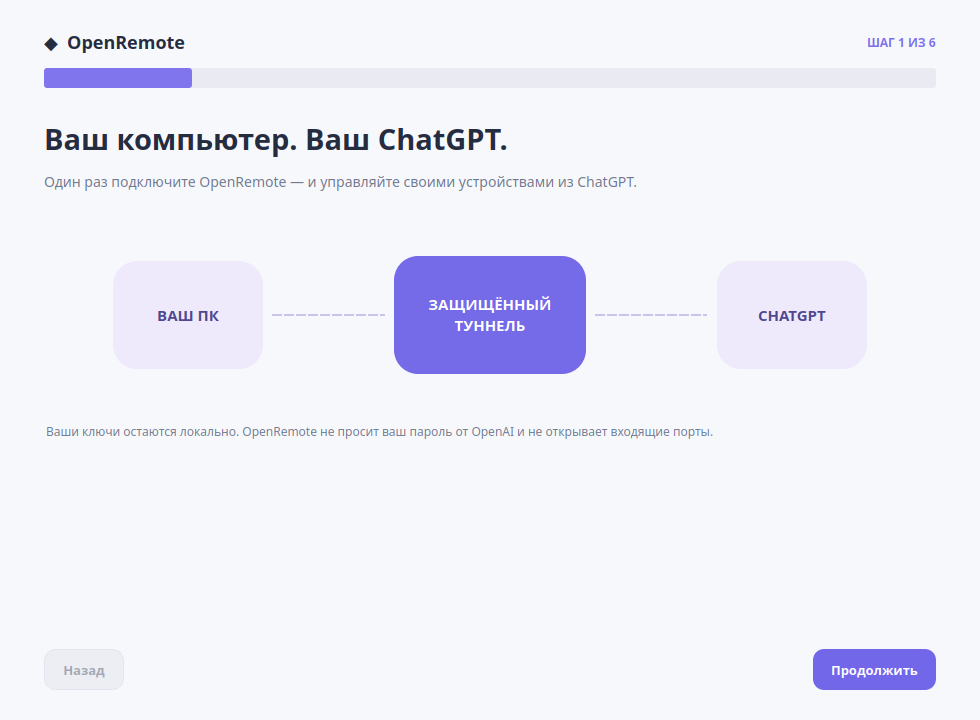
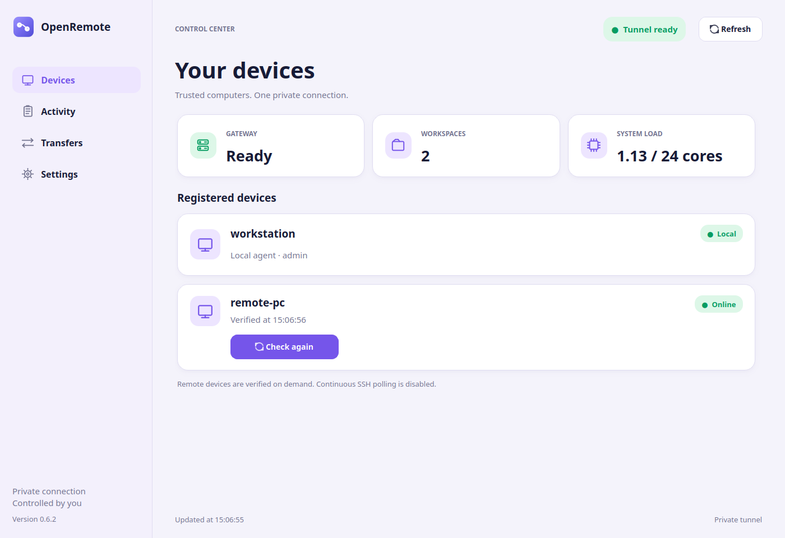

# OpenRemote

**A self-hosted MCP remote-control agent for your own Linux computers.** Connect a local machine to ChatGPT through an OpenAI Secure MCP Tunnel, and optionally route requests to other machines over SSH (including Tailscale). Each user deploys **their own private instance** with their own credentials, devices, and permissions.

> **Security warning:** OpenRemote can read and modify files and, if explicitly enabled, run arbitrary programs as the account hosting the agent. Treat its private ChatGPT connection as privileged access to your computer. Never publish a tunnel credential, share a private connector, or expose an unrestricted instance to strangers.

## What it does

- **Multiple machines:** select a registered device by its device ID. A gateway agent forwards to trusted peers using SSH with host-key verification.
- **Projects and files:** list owner-approved workspaces, read files, create new text files, and replace existing text only when its SHA-256 checksum matches.
- **Commands:** run named commands from a local allowlist. An opt-in advanced mode runs an executable and arguments without a fixed command-name blacklist.
- **Persistent jobs:** start long-running commands that survive MCP/SSH disconnects; page stdout/stderr, cancel a process group, inspect history, and clean old logs.
- **Binary transfer:** upload/download in bounded base64 chunks with resume offsets, a 1 GiB per-file limit, and SHA-256 integrity verification.
- **Approvals and audit:** role checks (viewer/operator/admin), one-time local approval for sensitive predefined commands, command timeouts, and an SQLite audit log.
- **Private ChatGPT integration:** an outbound Secure MCP Tunnel is used instead of opening an inbound port.
- **Parallel chats:** SQLite WAL, per-target file locks, bounded OS command slots, and optional task labels/idempotency keys prevent common conflicts between independent conversations.
- **Optional Linux desktop GUI:** a minimal dashboard with device checks, jobs, transfers, light/dark appearance, and minimize-to-tray on supported desktops.

**Current development version:** 0.6.2, Linux only, Python 3.11+, MCP SDK 1.29.0. This project is under active development and is not a production-grade multi-user remote-administration service.

## Install and connect in six steps — Linux .deb preview

**New users no longer need to edit JSON or operate a terminal** for the
standard personal setup. Install the preview `.deb`, launch OpenRemote
from the desktop menu, and follow the six-screen wizard to register an
OpenAI account, create a Secure MCP Tunnel, supply a restricted runtime
key and official tunnel-client, verify the local service, and create a
private ChatGPT plugin.

The OpenAI account, tunnel and ChatGPT plugin are created on the official
websites: **OpenRemote never asks for the OpenAI account password.**
A setup key is stored only in an owner-private `0600` file. The wizard
does not overwrite existing agent/tunnel configurations.

**Linux preview limitation:** the small `.deb` installs a desktop launcher
and wheel, then downloads Python/Qt dependencies from PyPI at **first launch**.
It is not an offline or fully bundled installer; the tested user environment
used about **302 MiB**. The official OpenAI tunnel-client must be downloaded
separately. Windows `.exe` installers and Windows/macOS agents are **not
available or verified** yet.

Read [first-run onboarding and Debian package details](docs/ONBOARDING.md)
for requirements, screenshots, security boundaries and recovery.

**Existing installations** automatically prefer a valid user-owned
\`~/.config/openremote-agent/agent.json\`, then a hostname-matched
\`<device>.json\` (such as \`terra.json\` on terra). In that case the GUI
opens the dashboard and **does not run first-time tunnel onboarding again**.
The existing runtime key, tunnel profile and user service are left unchanged.
No root access is required for a user-scoped launcher extracted from the Debian
package, though a true system \`dpkg\` installation requires administrator rights.

## Optional desktop Control Center

*Demo screenshot uses synthetic device and connection data.*

On a supported Linux graphical desktop, install the optional GUI with
`python -m pip install '.[gui]'`, then run `openremote-gui --config
~/.config/openremote-agent/agent.json`. Closing/minimizing hides the window
in the system tray **only when a tray is available**. The MCP agent keeps
running independently. See [GUI](docs/GUI.md) and
[parallel chat safety](docs/MULTI_CHAT.md).

## Start here

**[Step-by-step installation and ChatGPT setup →](docs/QUICKSTART.md)**

The guide covers:

1. Installing OpenRemote on a Linux computer.
2. Creating a private configuration and selecting permitted workspaces.
3. Adding a second computer using SSH or Tailscale (optional).
4. Creating your own OpenAI Secure MCP Tunnel and running tunnel-client.
5. Installing your own private custom MCP plugin in ChatGPT.
6. Checking tools, logs, access controls, and common connection failures.

A minimal local installation (read-only by default):

~~~bash
git clone https://github.com/NikDevPy/OpenRemote.git
cd OpenRemote
python3 -m venv .venv
.venv/bin/python -m pip install .
mkdir -p "$HOME/.config/openremote-agent"
cp examples/local-agent.example.json "$HOME/.config/openremote-agent/agent.json"
chmod 600 "$HOME/.config/openremote-agent/agent.json"
~~~

**Before running the agent**, edit the JSON file: replace YOUR_USER and create the indicated private directories (0700). Then:

~~~bash
.venv/bin/python -m openremote_agent.server \
  --config "$HOME/.config/openremote-agent/agent.json" --doctor
.venv/bin/python -m unittest discover -s tests -q
~~~

See the [quickstart](docs/QUICKSTART.md) for the remaining steps. Never copy somebody else's real tunnel ID, runtime API key, SSH credentials, or machine addresses into your configuration.

## MCP tools

| Tool | What it does | Access |
| --- | --- | --- |
| system_info | OS, architecture, and device ID | viewer |
| probe_device | Real read-only MCP health check for a registered device (briefly cached) | viewer |
| list_devices | Local and configured SSH peers | viewer |
| list_workspaces | Available file roots and read/write settings | viewer |
| list_files | List up to 100 entries in a workspace | viewer |
| read_text | Read UTF-8 text, up to 64 KiB, with SHA-256 | viewer |
| write_text | Create a new UTF-8 file; never overwrite | operator |
| replace_text | Replace existing text using expected SHA-256 | operator |
| preview_command | Inspect a predefined command's policy | viewer |
| execute_command | Execute a predefined command ID | operator / admin + local approval |
| run_argv | Opt-in arbitrary executable + arguments | admin + ad_hoc_enabled |
| audit_tail | Recent local audit events | admin |
| start_job | Launch a detached command (up to 6 hours) | admin + ad_hoc_enabled |
| job_status / list_jobs | Check persisted job status and history | admin |
| job_output | Read stored stdout/stderr in chunks | admin |
| cancel_job / purge_job | Stop a running job or delete completed logs | admin |
| binary_file_info / read_binary_chunk | Hash and download binary files in chunks | viewer |
| begin_upload / upload_chunk / upload_status | Start and resume binary uploads | operator |
| finish_upload / cancel_upload | Commit a hash-verified transfer or discard it | operator |

The **workspace restriction applies to file tools only**. It does **not** sandbox processes started with run_argv; such processes retain all permissions of their operating-system account. Avoid enabling run_argv unless you understand this distinction. The role in the current version is a server-level role, **not an identity verified independently for each ChatGPT user**.

## Architecture

~~~text
Your ChatGPT account (private custom MCP plugin)
                     |
          OpenAI Secure MCP Tunnel
          (outbound tunnel-client)
                     |
             OpenRemote gateway
               on your Linux PC
                     |
        +------------+-------------+
        |                          |
   Local workspaces            SSH / Tailscale
                                   |
                            OpenRemote peer
                              on your server
~~~

A public **GitHub repository** does not create a public **plugin**. Every person who uses OpenRemote must operate their own server, tunnel, and private ChatGPT connection. Secure MCP Tunnel is for private MCP integrations; public plugin submissions have different HTTPS and authentication requirements.

## Limitations

- Linux-focused; the optional desktop GUI is a Linux preview. No Windows/macOS native agent or verified GUI releases yet.
- Text file calls are limited to 64 KiB; **binary transfers** support files up to 1 GiB in 128 KiB raw chunks, with additional MCP/ChatGPT request limits.
- Direct `run_argv` calls are limited to 60 seconds and 8 KiB per output stream; **persistent jobs** run up to 6 hours and retain up to 8 MiB per output stream.
- The OpenAI tunnel has separate request, message-size, and rate limits. This is not an unlimited-throughput connection.
- Configured SSH peers are reported as configured, not automatically proven online.
- No per-user OAuth or hard subprocess isolation; **interactive PTY input is not yet available**. Background jobs and chunked binary transfers are supported.
- No guarantee that custom MCP plugins or Secure MCP Tunnel are enabled in every ChatGPT account/workspace.

## Documentation

- **[QUICKSTART — installation, SSH, tunnel and ChatGPT](docs/QUICKSTART.md)**
- **[SECURITY — privilege model, approvals, risk and isolation](docs/SECURITY.md)**
- **[TROUBLESHOOTING — tunnel, SSH, permissions, common errors](docs/TROUBLESHOOTING.md)**
- **[JOBS — persistent processes, output, cancellation, limits](docs/JOBS.md)**
- **[TRANSFERS — resumable binary files, SHA-256, chunking](docs/TRANSFERS.md)**
- **[MULTI_CHAT — concurrency safety and benchmarks](docs/MULTI_CHAT.md)**
- **[GUI — lightweight Qt tray app](docs/GUI.md)**
- **[DESIGN QA — bilingual reference screenshots, interaction and contrast checks](docs/DESIGN_QA.md)**
- [Owner-control technical notes](docs/owner-control.md)
- [SSH routing design notes](docs/ssh-routing.md)
- [Historical probe and compatibility research](docs/compatibility.md)

Some older engineering notes in docs/ are in Russian. The three user-facing guides above are in English.

## Development and contributing

~~~bash
.venv/bin/python -m unittest discover -s tests -v
~~~

Please do not submit runtime keys, tunnel IDs from your account, personal SSH hostnames/IP addresses, generated receipts, SQLite state, or private configurations in issues or pull requests.

See the [OpenAI Secure MCP Tunnel documentation](https://developers.openai.com/api/docs/guides/secure-mcp-tunnels) and [Add custom MCP server](https://developers.openai.com/api/docs/guides/custom-mcp-server) for the latest service requirements. Platform features and UI labels can change.

## License

OpenRemote is licensed under the [MIT License](LICENSE). Copyright (c) 2026 NikDevPy.

## Releases and compatibility

See [RELEASES](docs/RELEASES.md) for packaging plans, verified Linux architectures, and the current status of Windows and macOS. **Windows and macOS have not been tested or supported.** Do not interpret generic Python packaging as evidence of cross-platform compatibility.
