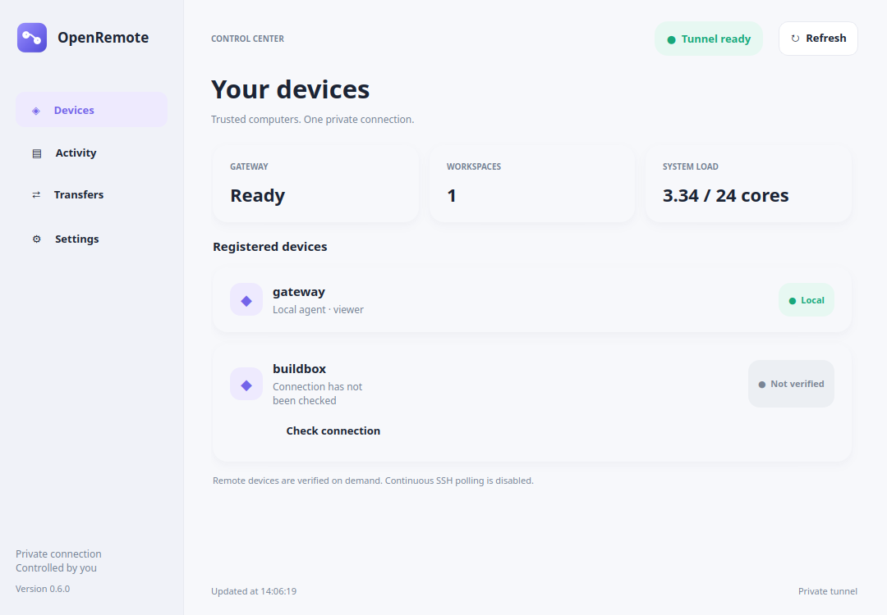

# OpenRemote Control Center — optional Linux desktop GUI (preview)

The Control Center is a minimal, Apple-inspired desktop dashboard. It is
**optional**: the OpenRemote gateway and SSH peers work entirely headless.
The GUI is a separate user process and has no access to OpenAI runtime keys.

## Features

- Devices: local gateway and registered SSH peers, basic machine health and
  workspace counts; remote peer verification **on demand only**.
- Activity: recent background job IDs and states, copyable job IDs.
- Transfers: pending local upload progress, without displaying file contents.
- Preferences: appearance and read-only information about local permissions.
- System tray: when supported, closing or minimizing **hides** the window;
  the tray menu can reopen, refresh, or quit the GUI. Quitting the GUI does
  not stop the background Secure MCP Tunnel systemd service.
- Prevents duplicate GUI processes in the same desktop user account via a
  local process lock. A second launch raises the existing window.

This is currently a **Linux preview**, with PySide6/Qt 6. Windows and macOS
GUI and agents have **not** been tested or supported.

## Install

~~~bash
git clone https://github.com/NikDevPy/OpenRemote.git
cd OpenRemote
python3 -m venv .venv
.venv/bin/python -m pip install '.[gui]'
.venv/bin/openremote-gui   --config "$HOME/.config/openremote-agent/agent.json"
~~~

Run it **from a graphical desktop login**, with a working X11 or Wayland Qt
session. If your private agent configuration uses another filename,
provide that file with `--config`. The dashboard does not require root or sudo. On a fresh installation,
 the setup wizard guides the owner through a private tunnel and runtime key.
The OpenAI account password is never entered in OpenRemote.

On a headless server, run the **agent only**, not the GUI. OpenRemote will
continue to serve ChatGPT without any graphical session.

## Tray behavior

Qt uses the desktop's supported system tray or StatusNotifierItem support.
On systems where a tray is available, the **X** button and minimize control
hide the window. Use the tray icon to show it again; use the explicit
**Quit OpenRemote UI** action to terminate only the GUI.

When a tray is unavailable, closing the window exits normally rather than
stranding an invisible application. Some minimal Linux shells require a
tray or AppIndicator extension. Actual tray support depends on the desktop,
not merely the Python OS version.

The app does **not** install an auto-start entry or start SSH sessions by
itself. Launch at graphical login using your desktop's standard Startup
Applications settings, if desired.

## Low resource usage

- Local state is scanned once every 30 seconds, using bounded metadata
  reads. It does **not** load command arguments, stdout/stderr, secrets,
  API keys, or binary content.
- Tunnel readiness is checked only against a loopback health endpoint.
- The `Check connection` button performs one trusted SSH invocation of the
  remote agent's `--doctor`; it is never part of the refresh timer.
- Refresh tasks run outside Qt's GUI thread. At most two GUI worker threads
  run concurrently. Completed workers are released.
- Only one GUI process may run per Linux desktop account. The MCP agent
  does **not** require any GUI process to remain alive.

## Visual smoke testing (without a desktop)

CI developers can validate rendering with Qt's offscreen backend:

~~~bash
QT_QPA_PLATFORM=offscreen .venv/bin/openremote-gui \
  --config "$HOME/.config/openremote-agent/agent.json" \
  --screenshot /tmp/openremote-control-center.png
~~~

The resulting image verifies a rendered window, **not** the operation of a
physical system tray or platform window manager.

**Observed real desktop test (2026-11-09):** on a GNOME Wayland desktop,
`QSystemTrayIcon.isSystemTrayAvailable()` returned true. An actual window
was opened, closed, and confirmed to be hidden while its tray icon stayed
visible. Other desktop shells and Windows/macOS have not been verified.

One GUI process on that Linux host used about **130 MiB RSS** during an
early running sample; this is a single-environment observation, not a
resource limit or benchmark guarantee. No Qt process is required on a
headless SSH peer.

See [MULTI_CHAT](MULTI_CHAT.md), [JOBS](JOBS.md) and [SECURITY](SECURITY.md).

## Graphical first-run installer

An experimental `.deb` setup path now exists, including a six-step
OpenAI tunnel wizard and installed application icon. It avoids manual JSON
edits and starts with safe viewer permissions. Read
[ONBOARDING](ONBOARDING.md) for screenshots, dependencies and limitations.
