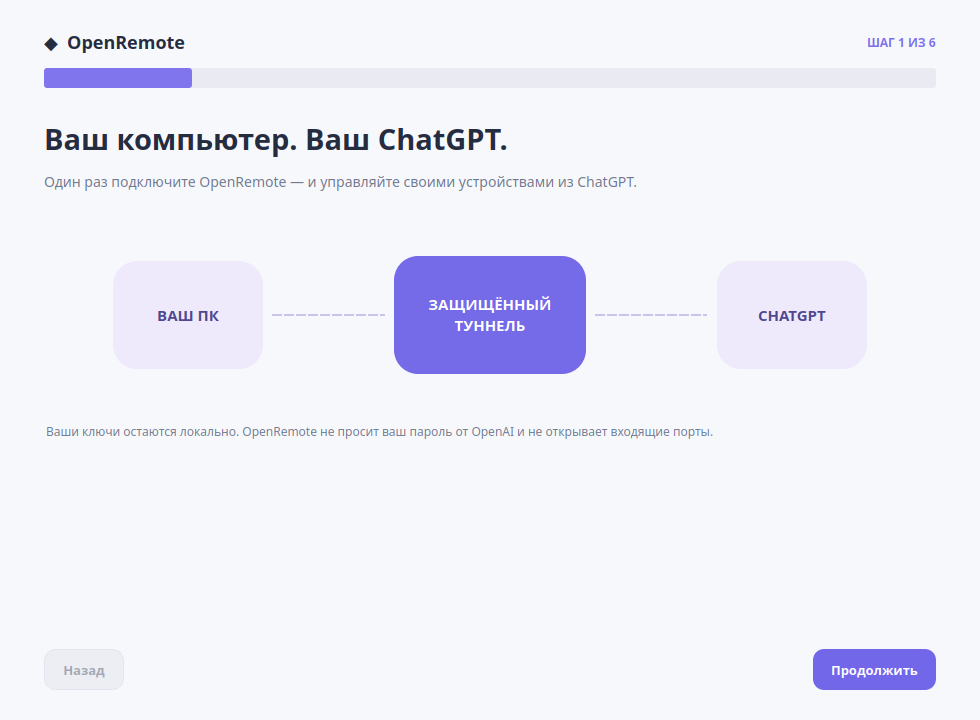
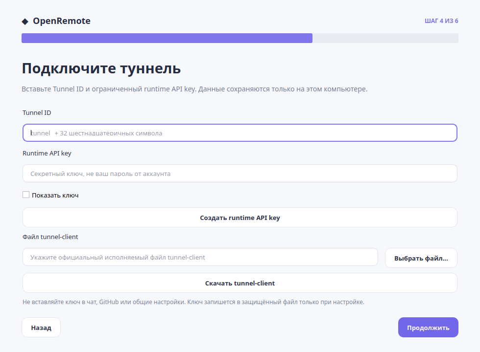
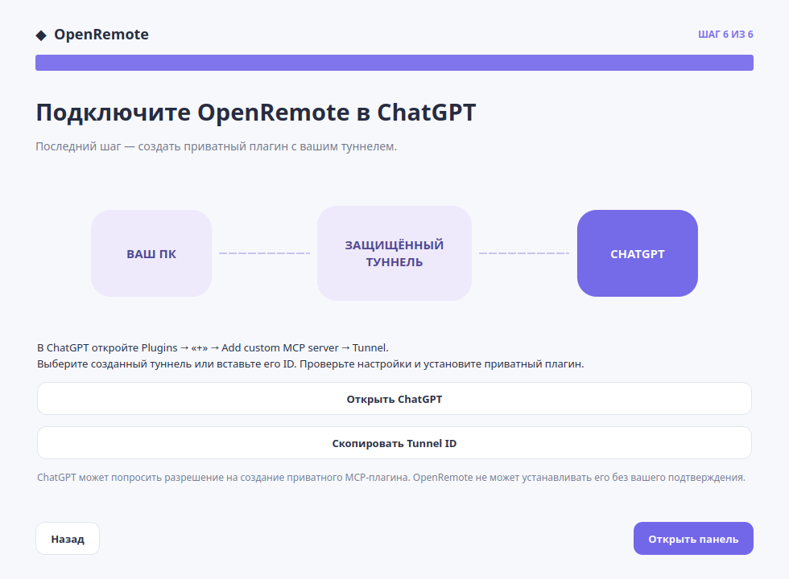

# OpenRemote first-run setup — Linux preview

**Goal:** download the Linux \`.deb\`, open the installed OpenRemote app,
and follow six short onboarding screens without editing JSON or using a shell.

## Installation

The Debian package is an **amd64 preview**, built with
\`scripts/build_linux_deb.sh\`. For a packaged release, download an official
release asset from the [OpenRemote GitHub Releases page](https://github.com/NikDevPy/OpenRemote/releases)
when one is available. Do not assume a release was published just because
the build script exists.

On Debian/Ubuntu-compatible systems, open the \`.deb\` in your software
installer, install it, then launch **OpenRemote** from your applications menu.
Alternatively, a developer with a checkout can build and inspect the
package locally:

~~~bash
python3 -m pip install build
bash scripts/build_linux_deb.sh dist
dpkg-deb -I dist/openremote-control-center_*.deb
~~~

**What this preview installs:** a Linux desktop entry and SVG application
icon, a tiny bootstrap executable, and a wheel with OpenRemote source.
The Debian package does **not** include the official OpenAI
\`tunnel-client\` binary, runtime API keys, an OpenAI account or user
configuration files.

**Important first-launch trade-off:** on the first launch the bootstrap
downloads Python/Qt dependencies from PyPI and installs them into a private,
versioned user virtual environment. Internet access is required. The
package does not run \`pip\` as root and does not download anything in
Debian's \`postinst\` script. On the Linux test system this first-run
environment used approximately **302 MiB** of local disk space. A later
fully bundled installer could reduce setup friction, but would need
separate OS/architecture compatibility testing.

## Onboarding steps

### 1 — Welcome

The wizard explains that OpenRemote is a private MCP agent. It runs on your
computer and forwards requests through an OpenAI Secure MCP Tunnel. No
inbound public port is required.

### 2 — OpenAI account

Use the **Open OpenAI registration** button if you don't already have a
Platform account. Authentication happens in your browser directly on
OpenAI's website, **not** in OpenRemote. The application never requests
your OpenAI username/password or browser session cookies.

### 3 — Secure MCP Tunnel

Open [Platform tunnel settings](https://platform.openai.com/settings/organization/tunnels),
create a personal private tunnel and associate it with the right
OpenAI Platform organization **and ChatGPT workspace**. The creator needs
Tunnels Read + Manage; the user/runtime key needs Tunnels Read + Use.
Copy the exact tunnel ID from the Platform settings.

### 4 — Credentials and tunnel-client

Enter the tunnel ID and a restricted *runtime API key* obtained in
[Platform API key settings](https://platform.openai.com/settings/organization/api-keys).
The key is masked in the UI and written to a private \`0600\` file only
after the user explicitly starts setup. It is never sent to GitHub,
ChatGPT, the application's settings store or screenshots.

Install the official \`tunnel-client\` downloaded from
[openai/tunnel-client Releases](https://github.com/openai/tunnel-client/releases/latest),
then choose its local executable in the wizard. Use only a source you
trust; the selected executable receives the runtime key when configuring
the tunnel. This preview **does not** automatically install third-party
binaries or circumvent system security settings.

### 5 — Configure and verify the local agent

Give this device a name and choose **Configure and start tunnel**.

The wizard then:
1. Creates private agent state and workspace directories in the user's home.
2. Creates a conservative agent config: role \`viewer\`, dynamic commands off.
3. Verifies the agent and the selected official tunnel-client.
4. Stores the runtime key locally, with permissions \`0600\`.
5. Runs \`tunnel-client init\` and \`doctor\` with the key in the child
   process environment, never in command-line arguments.
6. Installs a private \`systemd --user\` service and starts it.

Existing configurations, different runtime keys, unrelated profiles or
systemd units **are not overwritten**. A retry using the identical key,
ID, profile and wrapper is supported. If the official tool or service
fails, the wizard reports the failed stage without showing raw
stdout/stderr which might contain sensitive content.

This setup requires a working Linux user systemd manager. It does not grant
sudo privileges or enable unrestricted command execution.

### 6 — Connect ChatGPT

Open ChatGPT, select **Plugins → + → Add custom MCP server**,
choose **Connection: Tunnel**, select or paste the matching tunnel ID,
review the security prompts and create/install your *private* plugin.

**The OpenRemote wizard cannot automatically approve or install a plugin
in your ChatGPT account.** Your account and workspace must have the
required permissions. See the
[official Secure MCP Tunnel guide](https://developers.openai.com/api/docs/guides/secure-mcp-tunnels).

## GUI and operation

After onboarding, OpenRemote opens the normal bilingual Control Center
and can hide in the Linux system tray where supported.
The background tunnel service is independent of the GUI.

Use Settings to opt in to launching the *GUI* at graphical login. Closing
the GUI does not stop the tunnel agent. No automatic root service is created.
Parallel ChatGPT conversations share one agent and its concurrency controls.

See [GUI](GUI.md), [MULTI_CHAT](MULTI_CHAT.md),
[SECURITY](SECURITY.md) and [TROUBLESHOOTING](TROUBLESHOOTING.md).

## Platform support

- Linux amd64: Debian preview build and first-run launcher tested on one
  Linux x86_64 development host. Compatibility with all Ubuntu/Debian
  versions is **not** established.
- Linux ARM64: the agent works over SSH on the test device; the GUI and
  \`.deb\` onboarding package have not been validated there.
- Windows: no verified \`.exe\` setup or native agent yet.
- macOS: no verified native agent or packaged GUI yet.

A Windows installer will require Windows-native filesystem/process/permission
handling and integration tests, not just bundling the current Linux agent
into an executable. Do not publish or label a Windows/macOS installer as
working until those tests pass.

## Reusing an existing authorized agent after an update

OpenRemote discovers \`~/.config/openremote-agent/agent.json\` first, then
a config named after the computer's hostname (for example \`terra.json\`).
The dashboard opens immediately when such a configuration exists, so you
**do not need to register again, create a new tunnel, or enter the API key**.
The GUI is independent of the existing \`systemd --user\` tunnel.

An explicit \`--config PATH\` always overrides discovery.

### Linux troubleshooting

If the desktop menu opens an outdated version, check whether your home
directory contains an older \`~/.local/share/applications/openremote-control-center.desktop\`
file. User desktop entries override matching system-wide entries. Remove or
update the older entry after backing it up; restarting the tunnel service
is not necessary. When system package privileges are not available,
the \`.deb\` can also be extracted into an owner-only home directory and
launched with \`OPENREMOTE_ASSET_ROOT\` pointing to the extracted wheel.
This installs the GUI **for that user only**; it is not the same as a
system-wide \`dpkg\` installation.

The 0.6.1 preview fixes a fixed-width illustration that caused the
Russian “SECURE TUNNEL” label to overflow. The labels are now measured
before painting, tested at several window sizes in both languages.
